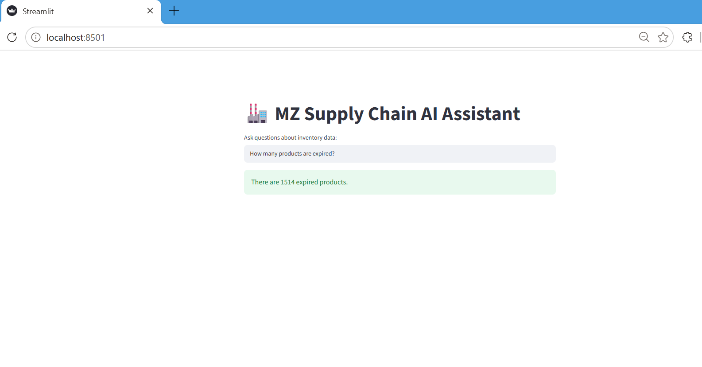
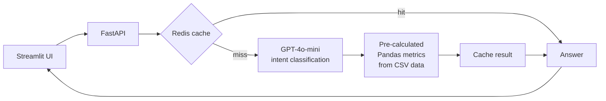
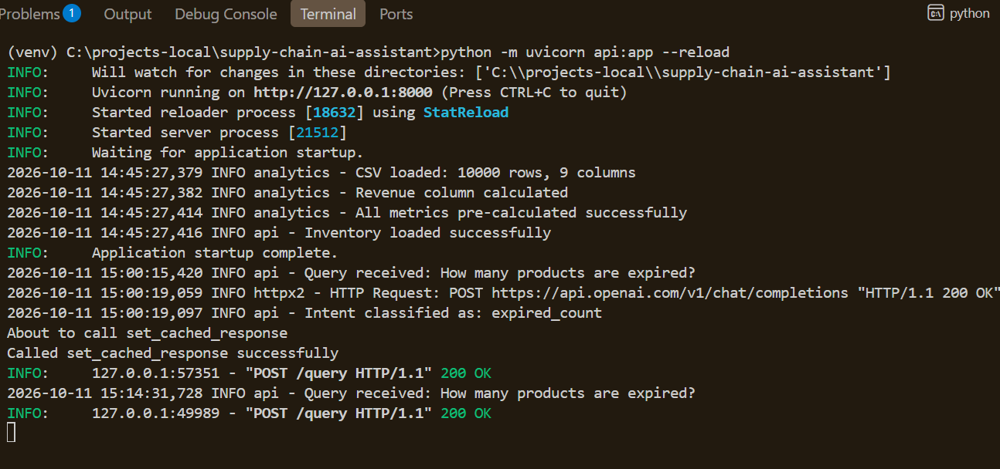

# MZ Supply Chain Q&A

**Ask questions about 10,000+ SKUs of inventory data in plain English and get exact answers instantly.**




> **Deployment note:** The API was deployed on AWS EC2 using Docker and Amazon ECR, with a GitHub Actions CI/CD pipeline. I have taken the instance down to avoid ongoing costs, so there is no live link. It runs locally (see [Run it locally](#run-it-locally)).

---

## Why I built this

I spent 6 years in supply chain and logistics. As a Supply Chain Analyst I managed demand and supply for 1,000+ SKUs, and every expiry or inventory question meant opening Excel, filtering, and building a report by hand. I wanted to fix that: a planner types a question and gets the answer immediately, with no analyst in the loop.

## What it can answer

1. How many products are expired?
2. Which products are expiring in the next 7 days?
3. Which brand has the most expired products?
4. Which brand has the highest revenue?
5. What is the total inventory value?
6. Which category has the most stock?
7. Which products have zero stock?
8. What is the expiry rate by brand?
9. Which brands need urgent attention?
10. Show me the top 10 products.

Questions can be phrased freely; the system maps them to one of these 10 metrics.

## How it works





1. Streamlit sends the question to the FastAPI backend.
2. Redis is checked first. The cache key is the question text (trimmed and lowercased), and entries expire after 1 hour, so repeated questions return instantly without another LLM call.
3. On a miss, GPT-4o-mini classifies the question into one of the predefined metrics.
4. The matching pre-calculated Pandas metric is looked up.
5. The result is cached and returned.

## Key design decision: why I replaced RAG

My first version used RAG with LangChain, ChromaDB and Groq (LLaMA-3). It failed for two reasons:

- **Context limits.** With 10,000 rows on the free tier, the model only captured about 50 rows, so answers were based on a fraction of the data.
- **Wrong tool for the job.** RAG retrieves by semantic similarity. Questions like "total inventory value" or "which brand has the most expired stock" are calculations, not similarity searches.

I also tried a Pandas agent (see `experiments/pandas_v1.py`), but it was abandoned because of context window limits with 10,000+ rows.

The final design separates the two jobs: **the LLM only understands the question; Pandas does the maths.** Metrics are pre-calculated in code, so the numbers come from the data, not from the model.

**Lesson:** use RAG for unstructured documents, and deterministic computation for structured tabular data.

## Tech stack

| Layer | Tools |
|---|---|
| API | FastAPI, Pydantic |
| AI | OpenAI GPT-4o-mini, LangChain (intent classification) |
| Analytics | Pandas (data loaded from CSV) |
| Caching | Redis |
| Frontend | Streamlit |
| DevOps | Docker, GitHub Actions, AWS EC2, Amazon ECR |
| In progress | PostgreSQL, SQLAlchemy, Alembic, JWT authentication, rate limiting |

## Project structure

| Path | Purpose |
|---|---|
| `analytics.py` | Pandas class with the 10 pre-calculated metrics |
| `api.py` | FastAPI app, intent classifier and routing |
| `app.py` | Streamlit frontend |
| `app/cache.py` | Redis caching functions |
| `app/database.py`, `app/models.py` | PostgreSQL connection and schema (in progress) |
| `migrations/` | Alembic migration files (in progress) |
| `tests/` | Automated test suite |
| `experiments/` | Earlier approaches I tried and abandoned |
| `Dockerfile` | Builds the API image used for the AWS deployment |
| `.github/workflows/` | CI/CD pipeline |

## Run it locally

Requires Python 3.11+, an OpenAI API key, and Redis.

```bash
git clone https://github.com/MZ1503/supply-chain-ai-assistant
cd supply-chain-ai-assistant

python -m venv venv
venv\Scripts\activate         # Windows
source venv/bin/activate      # Mac/Linux
pip install -r requirements.txt

cp .env.example .env          # add your OpenAI API key to .env
docker run -p 6379:6379 redis # start Redis (or use a local Redis install)
```

Then start the API and the frontend in two terminals:

```bash
uvicorn api:app --reload      # terminal 1
streamlit run app.py          # terminal 2
```

Open `http://localhost:8501` for the app, or `http://localhost:8000/docs` for the API.

## Data

The API loads `data/inventory_data.csv` on startup. The data is **synthetic**, generated to reflect a realistic supply chain structure based on my logistics experience. It does not represent any real company's data.

Required columns: `BRAND`, `CATEGORY`, `ACTUAL_QTY`, `UNIT_PRICE_AED`, `DAYS_TO_EXPIRY`. See `data/sample_inventory.csv` for the structure.

## Engineering log

- **Caching:** added Redis so repeated questions return instantly without another LLM call. Also debugged a production disk-space issue in Docker on EC2.
- **Database layer (in progress):** designing a PostgreSQL schema (Product, Query, User) with Alembic migrations, to replace the CSV data source.
- **Authentication (in progress):** JWT authentication and rate limiting.

## Limitations

- It answers the 10 predefined questions. Questions outside them may be misclassified or not answered.
- Data is read from a CSV file; the PostgreSQL migration is not finished.
- Redis must be running for the API to work.
- Docker Compose setup for the whole stack is being updated; for now, use the local setup above.
- Based on synthetic data, not a live company system.
- Authentication and rate limiting are not finished, so it should not be exposed publicly.

## What I learned

- RAG is the wrong tool for structured tabular data.
- Pre-calculating metrics gives reliable, exact and fast answers.
- Separating intent classification from data retrieval makes the system easier to test and debug.
- Docker and CI/CD make deployment repeatable.

## Author

**Mariyam Zaidi**, backend engineer with a supply chain background.
[LinkedIn](https://www.linkedin.com/in/mariyam-z-b8a875380) · zaidii.mariyam@gmail.com
